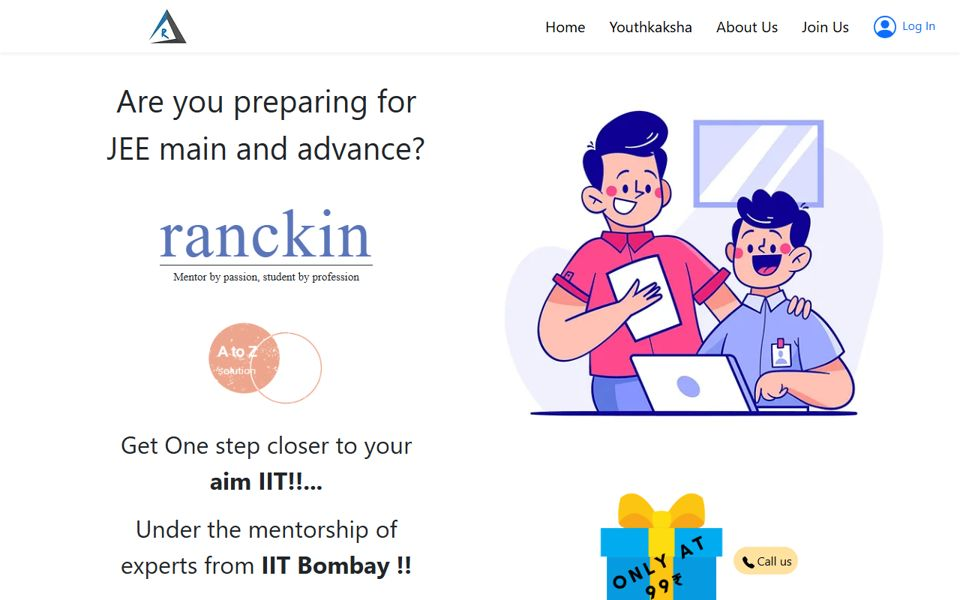
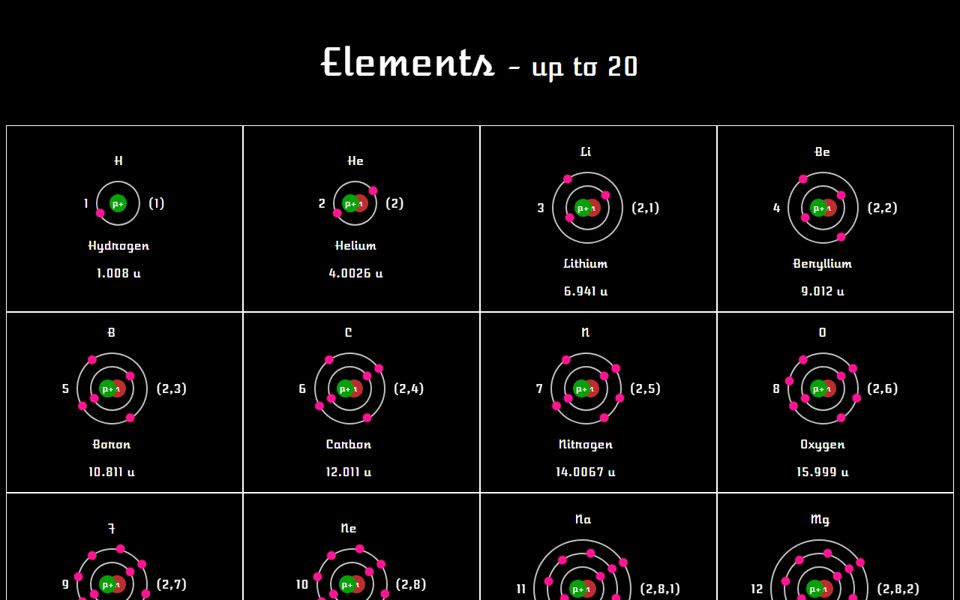

<!-- ───────────────────────── HERO ───────────────────────── -->

  

  

  
  
  
  

## About me

I'm Roushan, a B.Tech CSE student at **IIIT Bhubaneswar**, and I build where creativity, technology and AI meet. What I enjoy most is taking an idea that only exists in my head and making it real, whether that's a website for a client, a start-up idea or an experiment with AI tools.

I started on the web in 2021 with plain HTML pages and Hacktoberfest. In college I went back to the fundamentals: C, C++ and algorithms. Now I do both. I write lab code that gets checked against a second method, and I build sites for real clients with React and Three.js.

- 🎓 B.Tech CSE · IIIT Bhubaneswar · Batch of 2025–2029
- 🔭 Building client and brand sites ([Rechitta](https://rechitta-landing.vercel.app), [Lajjha](https://lajjah-reimagined.vercel.app/)) and a solar microgrid dashboard
- 🏆 Certificate of Excellence, Scaler Young Innovator Internship Challenge (Edition 4)
- 🧪 Hackathons: HCL Jigsaw Edition 7 with Team Pioneering Sol-Gen, and the Adobe University Hackathon 2026, where we cleared the DSA and SQL online round
- 💡 Into AI products, creative development and motion design, and startups. Photography and cybersecurity on the side
- 📫 Reach me at **sroushan2104@gmail.com**

## Featured work

<table>
<tr>
<td width="50%" valign="top">

**[Lajjha · लज्जा](https://github.com/Roushan-2104/Lajjah-reimagined)** 
Storytelling site for a handcrafted oxidised-silver jewellery label from Siliguri. Real-time 3D jewellery and a scroll-driven making story. 
   
[Live site](https://lajjah-reimagined.vercel.app/) · [Code](https://github.com/Roushan-2104/Lajjah-reimagined)
</td>
<td width="50%" valign="top">

**[Urasicous Clean Tech](https://github.com/Roushan-2104/Urasicous-Clean-Tech)** 
Landing page and live, simulated control room for a 40 kWp solar microgrid serving 50 homes in Rampur Kheda, Nashik. Built for HCL Jigsaw Edition 7. 
   
[Live site](https://urasicouscleantech.vercel.app) · [Code](https://github.com/Roushan-2104/Urasicous-Clean-Tech)
</td>
</tr>
<tr>
<td width="50%" valign="top">

**[Simple Text Editor](https://github.com/Roushan-2104/Simple-Text-Editor-using-CPP)** 
A desktop editor with C/C++ syntax highlighting, built from seven small classes that each do one job. OOP course project. 
  
[Code](https://github.com/Roushan-2104/Simple-Text-Editor-using-CPP)
</td>
<td width="50%" valign="top">
<!-- TODO: add a screenshot of the Streamlit app to the Clash_of_Minds repo and link it here -->

**[Clash of Minds](https://github.com/Roushan-2104/Clash_of_Minds)** 
A local AI debate arena. Two Llama 3.2 agents, an optimist and a skeptic, argue any motion so you can see the counter-arguments before you walk into a debate. 
   
[Code](https://github.com/Roushan-2104/Clash_of_Minds)
</td>
</tr>
</table>

**More I've built**

- **[DAA Lab Portfolio](https://github.com/Roushan-2104/B125103-DAA)** · 60 problems across 10 paradigms in C99, every answer checked against a second method
- **[Indian Income Tax Calculator](https://github.com/Roushan-2104/Project_Sem1)** · FY 2025-26 new regime in C, with the 87A rebate, marginal relief, surcharges and cess
- **[Rechitta](https://rechitta-landing.vercel.app)** · client project, a landing page live on Vercel
- **[MindMitra](https://mindmitra.lovable.app)** · a mental-health buddy for students facing academic stress, with an anonymous venting space. Built with Lovable AI during the Scaler internship
- **[CyberMind](https://cybermind.lovable.app)** · a hacker-themed mind map of cybersecurity branches with interactive 3D tiles, made from a single AI prompt

## Where it started · 2021–22

I built these while I was still in school. The first three were the most complex: full React apps with sign-in, a real-time Firebase database and their own custom hooks.

<a href="https://the-managment.web.app/">
<picture>
  <source media="(prefers-color-scheme: dark)" srcset="assets/2021/the-management-dark.svg" />
  
</picture>
</a>

<a href="https://the-managment.web.app/">Live app</a> · <a href="https://github.com/Roushan-2104/The-Management">Code</a>

<a href="https://my-money-625f9.web.app/">
<picture>
  <source media="(prefers-color-scheme: dark)" srcset="assets/2021/mymoney-dark.svg" />
  
</picture>
</a>

<a href="https://my-money-625f9.web.app/">Live app</a> · <a href="https://github.com/Roushan-2104/myMoney">Code</a>

<a href="https://github.com/Roushan-2104/Cooking-Ninja">
<picture>
  <source media="(prefers-color-scheme: dark)" srcset="assets/2021/cooking-ninja-dark.svg" />
  
</picture>
</a>

<a href="https://github.com/Roushan-2104/Cooking-Ninja">Code</a>

**Also from 2021–22**

<table>
<tr>
<td width="50%" valign="top">

**[Ranckin](https://github.com/Roushan-2104/Ranckin-IIT)** · Oct 2021 
Website for a JEE mentoring platform run by IIT Bombay mentors, with a login, a join flow and page transitions. 
   
[Live site](https://roushan-2104.github.io/Ranckin-IIT/) · [Code](https://github.com/Roushan-2104/Ranckin-IIT)
</td>
<td width="50%" valign="top">

**[Str-atom](https://github.com/Roushan-2104/Str-atom)** · Feb 2022 
The first 20 elements of the periodic table, each with its electrons orbiting the nucleus. Animated in pure CSS, no libraries. 
  
[Live site](https://roushan-2104.github.io/Str-atom/) · [Code](https://github.com/Roushan-2104/Str-atom)
</td>
</tr>
</table>

<b>More from 2021–22</b>

- **[My first portfolio](https://roushan-2104.github.io/)** · a personal site with a typing intro and a project gallery, on GitHub Pages
- **[SpaceX landing page](https://roushan-2104.github.io/SPACEX-LANDING-PAGE/)** · a SpaceX-style landing page with a video hero and its own phone layout
- **[Magic Memory: Avengers Edition](https://github.com/Roushan-2104/MAGIC-MEMORY-AVENGERS-EDITION)** · a card-matching memory game with Avengers cards, in React
- **[Image Sharer](https://github.com/Roushan-2104/IMAGE-SHARER)** · an image feed with uploads, built with Django
- **[Visual Graphics in C](https://github.com/Roushan-2104/Visual-Graphics-in-C)** · shapes, animations and sound with graphics.h
- **[Photos API](https://roushan-2104.github.io/IMAGE-ENGINE/)** · an image search on the Unsplash API
- **[Multiverse Image Gallery](https://roushan-2104.github.io/MULTIVERSE-IMAGE-GALLERY/)** · my Hacktoberfest 2021 project
- **[Python mini apps](https://github.com/Roushan-2104/PYTHON)** · a banking app, a PokéAPI client and rock-paper-scissors
- **[The World of Games](https://github.com/Roushan-2104/theworldofgames)** · the first webpage I ever published

## Journey

<picture>
  <source media="(prefers-color-scheme: dark)" srcset="assets/journey-dark.svg" />
  
</picture>

## Tech I use

| | |
|---|---|
| **Languages** |  |
| **Web** |  |
| **Tools** |  |

## GitHub activity

  

  

## Say hello

  

  

