<picture>
  <source media="(prefers-color-scheme: dark)" srcset="cards/hero-dark.svg" />
  
</picture>

<a href="https://www.linkedin.com/in/sroushan2104/"><picture><source media="(prefers-color-scheme: dark)" srcset="cards/link-linkedin-dark.svg" /></picture></a>
<a href="mailto:sroushan2104@gmail.com"><picture><source media="(prefers-color-scheme: dark)" srcset="cards/link-email-dark.svg" /></picture></a>
<a href="https://x.com/sroushan2104"><picture><source media="(prefers-color-scheme: dark)" srcset="cards/link-x-dark.svg" /></picture></a>

<picture>
  <source media="(prefers-color-scheme: dark)" srcset="cards/building-dark.svg" />
  
</picture>

## About me

**I love creating.** My favourite part is taking an idea that only exists in my head and making it real, whether that's a website for a client, a start-up idea or an experiment with AI.

I'm studying Computer Science at **IIIT Bhubaneswar** (2025–29), and I work where technology, creativity and AI meet. I'm into:

- 🧩 Building products that solve real problems
- 🤖 AI and new tech, put to practical use
- 🎨 Creative development and motion design
- 🚀 Startups, and taking ideas from zero to launch

I learn best by building. If you're working on something interesting or a little out of the box, let's connect.

<picture><source media="(prefers-color-scheme: dark)" srcset="cards/stack-dark.svg" /></picture>
<picture><source media="(prefers-color-scheme: dark)" srcset="cards/languages-dark.svg" /></picture>

<picture>
  <source media="(prefers-color-scheme: dark)" srcset="cards/heatmap-dark.svg" />
  
</picture>

<picture>
  <source media="(prefers-color-scheme: dark)" srcset="cards/activity-dark.svg" />
  
</picture>

<a href="https://github.com/Roushan-2104/Shammy-Notch-For-Windows"><picture><source media="(prefers-color-scheme: dark)" srcset="cards/build-dark.svg" /></picture></a>
<a href="https://github.com/Roushan-2104/Jeevan-Dhara"><picture><source media="(prefers-color-scheme: dark)" srcset="cards/ai-dark.svg" /></picture></a>
<a href="https://github.com/Roushan-2104/Lajjah-reimagined"><picture><source media="(prefers-color-scheme: dark)" srcset="cards/create-dark.svg" /></picture></a>

<a href="https://github.com/Roushan-2104/Shammy-Notch-For-Windows">
<picture>
  <source media="(prefers-color-scheme: dark)" srcset="cards/repo-shammy-notch-for-windows-dark.svg" />
  
</picture>
</a>

<picture>
  <source media="(prefers-color-scheme: dark)" srcset="cards/journey-dark.svg" />
  
</picture>

Cards are animated SVGs rendered by <a href="scripts/render_readme_cards.py">one Python script</a> and refreshed daily by a GitHub Action.
