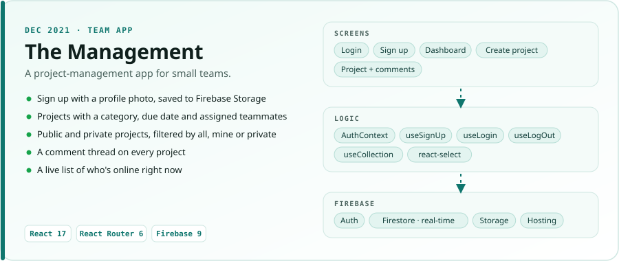
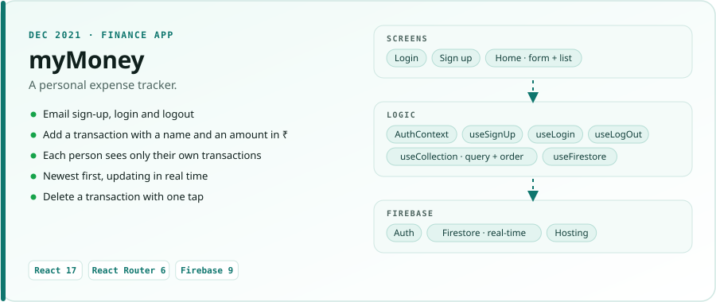
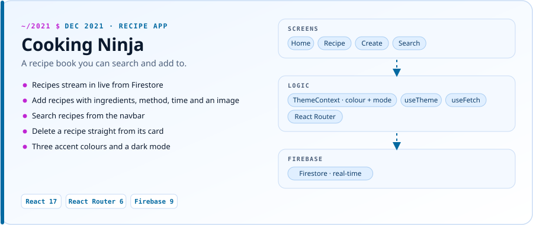

## About me

**I love creating.** My favourite part is taking an idea that only exists in my head and making it real, whether that's a website for a client, a start-up idea or an experiment with AI.

I'm studying Computer Science at **IIIT Bhubaneswar** (2025–29), and I work where technology, creativity and AI meet. I'm into:

- 🧩 Building products that solve real problems
- 🤖 AI and new tech, put to practical use
- 🎨 Creative development and motion design
- 🚀 Startups, and taking ideas from zero to launch

I learn best by building. If you're working on something interesting or a little out of the box, let's connect.

## Tech and activity

| | |
|---|---|
| **Languages** |  |
| **Frontend** |  |
| **Backend** |  |
| **Tools** |  |

  

## Recent projects

<table>
<tr>
<td width="50%" valign="top">

**[Lajjha · लज्जा](https://lajjah-reimagined.vercel.app/)** 
A storytelling site with real-time 3D jewellery for a silver label from Siliguri. 
React · Three.js · Vite
</td>
<td width="50%" valign="top">

**[Urasicous Clean Tech](https://urasicouscleantech.vercel.app)** 
A live control room for a solar microgrid serving 50 village homes. 
HTML · CSS · JavaScript
</td>
</tr>
</table>

- **[Rechitta](https://rechitta-landing.vercel.app)** · a landing page for a client
- **[Clash of Minds](https://github.com/Roushan-2104/Clash_of_Minds)** · two local AI agents debate any topic, on Llama 3.2

## Where it started · 2021–22

I built these while still in school: full React apps with sign-in and a real-time Firebase database.

<a href="https://the-managment.web.app/">
<picture>
  <source media="(prefers-color-scheme: dark)" srcset="assets/2021/the-management-dark.svg" />
  
</picture>
</a>

<a href="https://my-money-625f9.web.app/">
<picture>
  <source media="(prefers-color-scheme: dark)" srcset="assets/2021/mymoney-dark.svg" />
  
</picture>
</a>

<a href="https://github.com/Roushan-2104/Cooking-Ninja">
<picture>
  <source media="(prefers-color-scheme: dark)" srcset="assets/2021/cooking-ninja-dark.svg" />
  
</picture>
</a>

<b>More from 2021–22</b>

- [Ranckin](https://roushan-2104.github.io/Ranckin-IIT/) · a JEE mentoring site
- [Str-atom](https://roushan-2104.github.io/Str-atom/) · the periodic table with electrons orbiting in pure CSS
- [My first portfolio](https://roushan-2104.github.io/) · and a [SpaceX landing page](https://roushan-2104.github.io/SPACEX-LANDING-PAGE/)
- [Magic Memory](https://github.com/Roushan-2104/MAGIC-MEMORY-AVENGERS-EDITION) · an Avengers card-matching game in React
- [Image Sharer](https://github.com/Roushan-2104/IMAGE-SHARER) · an image feed in Django

## Journey

<picture>
  <source media="(prefers-color-scheme: dark)" srcset="assets/journey-dark.svg" />
  
</picture>
